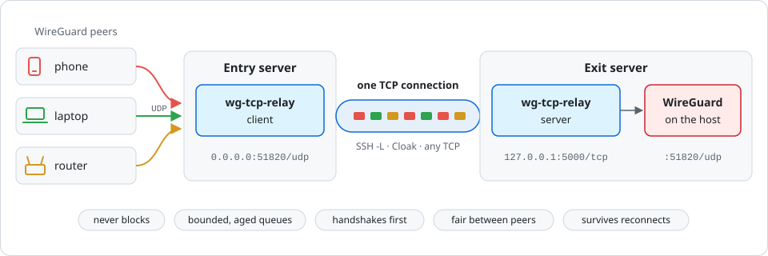

# wg-tcp-relay

WireGuard over TCP that does not stall.

`wg-tcp-relay` carries the traffic of many WireGuard peers over **one TCP connection**, such as
an SSH port forward or a [Cloak](https://github.com/navrocky/wg-tcp-relay/blob/main/docs/cloak.md)
tunnel. It is meant for networks where UDP between your servers is blocked or throttled. It
understands WireGuard, and it follows one rule: **under load, drop packets; never queue them
for seconds and never block.**

<p align="center">
  
</p>

Peers keep their WireGuard configs: only the `Endpoint` changes, from the exit server to the
entry server.

## Why

Generic UDP-over-TCP tunnels tend to fail with WireGuard in two ways:

- **Stalls.** One slow flow blocks the others, and "the VPN hangs until I reconnect".
- **Bufferbloat.** TCP queues packets instead of losing them, so a single speedtest adds
  seconds of latency for every user of the tunnel.

`wg-tcp-relay` avoids both:

- it never waits on a UDP socket;
- each peer gets a small queue, and packets that wait too long are dropped;
- WireGuard handshakes and keepalives skip the queue;
- peers get the link in turns (round-robin);
- sessions survive reconnects of the TCP connection.

[How it compares to wstunnel, udp2raw, udp-over-tcp and others](https://github.com/navrocky/wg-tcp-relay/blob/main/docs/alternatives.md).

## Quick start

The example uses an SSH forward as the transport, with WireGuard running on the exit server's
host on `51820/udp`.

**1. Exit server.** Run the relay server next to WireGuard:

```yaml
services:
  wg-tcp-relay:
    image: navrocky/wg-tcp-relay:0.1
    command: server --listen 127.0.0.1:5000 --target 127.0.0.1:51820
    network_mode: host
    restart: unless-stopped
```

**2. Entry server.** Forward a local port to the relay server over SSH:

```sh
ssh -N -L 127.0.0.1:5000:127.0.0.1:5000 \
    -o ServerAliveInterval=10 -o ServerAliveCountMax=3 \
    -o ExitOnForwardFailure=yes \
    -o ConnectTimeout=15 \
    -o Compression=no \
    user@exit.example.com
```

What the options do:

- `-N -L 127.0.0.1:5000:127.0.0.1:5000`: only forwards the entry server's local port 5000 to
  port 5000 on the exit server; no shell.
- `ServerAliveInterval=10`, `ServerAliveCountMax=3`: notice a dead connection within about
  30 s instead of minutes, and exit so it gets restarted.
- `ExitOnForwardFailure=yes`: exit if the forward cannot be set up, instead of staying
  connected without it.
- `ConnectTimeout=15`: retry quickly when a connection attempt hangs.
- `Compression=no`: WireGuard traffic is encrypted and does not compress.

Keep the command running and restart it when it exits, for example with a systemd service with
`Restart=always`. Use a separate SSH connection for anything else you forward: the relay's
connection should carry only WireGuard.

Then run the relay client:

```yaml
services:
  wg-tcp-relay:
    image: navrocky/wg-tcp-relay:0.1
    command: client --listen 0.0.0.0:51820 --connect 127.0.0.1:5000
    network_mode: host
    restart: unless-stopped
```

**3. Peers.** Set `Endpoint = entry.example.com:51820` and allow `51820/udp` in the entry
server's firewall.

The [SSH guide](https://github.com/navrocky/wg-tcp-relay/blob/main/docs/ssh.md) covers a
restricted tunnel user, sshd settings and reverse (`-R`) tunnels.
[Installing with systemd](https://github.com/navrocky/wg-tcp-relay/blob/main/docs/systemd.md)
covers setups without Docker, with ready-made units. Static binaries are attached to every
[release](https://github.com/navrocky/wg-tcp-relay/releases).

## Documentation

- [Installing with systemd](https://github.com/navrocky/wg-tcp-relay/blob/main/docs/systemd.md): binary, units, sysctls, no Docker
- [SSH transport](https://github.com/navrocky/wg-tcp-relay/blob/main/docs/ssh.md): options, restricted user, sshd, reverse tunnels
- [Cloak transport](https://github.com/navrocky/wg-tcp-relay/blob/main/docs/cloak.md): TCP disguised as TLS, for networks with DPI
- [Configuration](https://github.com/navrocky/wg-tcp-relay/blob/main/docs/configuration.md): all options and environment variables
- [Tuning and benchmarks](https://github.com/navrocky/wg-tcp-relay/blob/main/docs/tuning.md): `--max-rate-mbit`, congestion control, kernel settings
- [Troubleshooting](https://github.com/navrocky/wg-tcp-relay/blob/main/docs/troubleshooting.md): reading the logs, typical problems
- [Alternatives](https://github.com/navrocky/wg-tcp-relay/blob/main/docs/alternatives.md): wstunnel, udp2raw, udp-over-tcp and others
- [Development](https://github.com/navrocky/wg-tcp-relay/blob/main/docs/development.md): building, tests, the end-to-end bench, releases
- [Changelog](https://github.com/navrocky/wg-tcp-relay/blob/main/CHANGELOG.md)

## License

MIT
